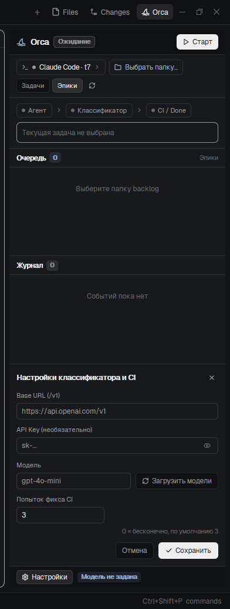

# herdr-orca

Оркестратор бэклога для [Herdr](https://herdr.dev): автоматически отслеживает работу агента в выбранной сессии, проверяет завершение хода через OpenAI-compatible модель-классификатор, ждёт и проверяет GitHub CI/CD каждые 5 минут, отправляет логи упавшего CI обратно агенту на фикс и переводит выполненные задачи в `DONE`, запуская следующую задачу из `backlog/*.md`.



## Возможности

- **Кнопка и панель в интерфейсе (`main-orca` + `tabs-orca` + `agents-orca`):**
  - Кнопка **Orca** в верхней панели рядом с `Files` и `Changes` с живой анимацией статуса (спиннер при работе/анализе/фиксе, пульсирующая точка при ожидании CI, индикатор при паузе/ошибке; логотип Orca остаётся ровным).
  - В левой панели **Agents** (`agents-orca`) вместо `Idle` отображается пульсирующая метка **`Waiting`** (и отдельная секция `Waiting`), пока Orca/ревьювер проверяет или ждёт этого агента.
  - Правая панель продолжает работать в фоне, даже если переключиться на `Files`/`Changes` или скрыть панель.
- **Очередь из `backlog/*.md`:**
  - Автопоиск `backlog/`, `docs/backlog/`, `.backlog/` в активном `space` (включая корень git-репозитория) или выбор папки вручную.
  - Режимы **Задачи** и **Эпики**, сортировка по приоритету `P0`–`P3` и номеру.
  - Синхронизация статусов по формату `herdr-kanban` (`[ ] TODO`, `[-] IN PROGRESS`, `[!] BLOCKED`, `[x] DONE`) и безопасная запись через `writeTextFile` с проверкой исходного снимка.
- **Два режима классификатора (OpenAI-compatible):**
  - **Авто** — быстрая проверка завершения хода по хвосту терминала (`hc read`), `git status`, `git log` и статусу CI (`completed`, `waiting_ci`, `needs_user`, `failed`) и отправка следующей задачи.
  - **Ревьювер** — глубокая проверка качества решения и выявление заглушек/фальсификаций: модель получает read-only инструменты (`read_terminal`, `git_status`, `git_diff`, `list_files`, `read_file`) и заранее собранный diff, проверяет реальные изменения и тесты, а при замечаниях (`needs_fix`) возвращает задачу агенту на доработку (с fallback на одношаговую проверку, если endpoint не поддерживает `tools`).
  - Настройки внизу панели: `Base URL (/v1)`, необязательный `API Key` (скрытый ввод), загрузка списка моделей из `GET /models`, выбор модели, **Попыток фикса CI** и **Попыток ревью** (`0 = бесконечно, по умолчанию 3`).
- **Цикл GitHub CI/CD и авто-фикс:**
  - При `waiting_ci` (или `pending` CI) проверяет `gh run list` / `gh pr checks` каждые **5 минут** (плюс кнопка **Проверить CI**).
  - Если CI зелёный — отмечает задачу `[x] DONE` и отправляет следующую в ту же сессию (`hc send`).
  - Если CI упал — забирает хвост лога ошибки (`gh run view --log-failed`) и отправляет агенту на фикс.
  - Лимит попыток фикса задаётся в настройках (`3` по умолчанию, `0` = бесконечно). При исчерпании попыток или ошибке останавливается и отправляет звуковое уведомление Herdr (`notify` + `playSound("blocked")`).

## Установка

Клонируйте репозиторий:

```sh
git clone https://github.com/rslnmzhn/herdr-orca.git
```

### Windows (PowerShell / cmd)

Создайте junction-ссылки и скопируйте layout в `%USERPROFILE%\.config\herdr-app`:

```cmd
mklink /J "%USERPROFILE%\.config\herdr-app\mods\orca" "<path-to-repo>\herdr-orca\mods\orca"
mklink /J "%USERPROFILE%\.config\herdr-app\mods\tabs-orca" "<path-to-repo>\herdr-orca\mods\tabs-orca"
mklink /J "%USERPROFILE%\.config\herdr-app\mods\agents-orca" "<path-to-repo>\herdr-orca\mods\agents-orca"
copy "<path-to-repo>\herdr-orca\layouts\main-orca.json" "%USERPROFILE%\.config\herdr-app\layouts\main-orca.json"
```

### macOS / Linux

```sh
ln -s /path/to/herdr-orca/mods/orca ~/.config/herdr-app/mods/orca
ln -s /path/to/herdr-orca/mods/tabs-orca ~/.config/herdr-app/mods/tabs-orca
ln -s /path/to/herdr-orca/mods/agents-orca ~/.config/herdr-app/mods/agents-orca
cp /path/to/herdr-orca/layouts/main-orca.json ~/.config/herdr-app/layouts/main-orca.json
```

Переключитесь на layout `main-orca`:

```sh
herdr-app do layout.switch '{"name":"main-orca"}'
```

## Настройка и запуск

1. Нажмите кнопку **Orca** в правом верхнем углу окна Herdr (рядом с `Files` и `Changes`).
2. Внизу панели нажмите **Настройки**:
   - укажите `Base URL (/v1)` (например, `http://localhost:11434/v1` или ваш OpenAI-compatible endpoint);
   - при необходимости введите `API Key`;
   - нажмите **Загрузить модели** и выберите модель;
   - задайте **Попыток фикса CI** и **Попыток ревью** (`0 = бесконечно, по умолчанию 3`);
   - нажмите **Сохранить**.
3. Выберите живую сессию агента и папку `backlog/`, затем нажмите **Старт**.

## Проверка и тесты

```sh
bun test
herdr-app check ~/.config/herdr-app/mods/orca
herdr-app check ~/.config/herdr-app/mods/tabs-orca
herdr-app check ~/.config/herdr-app/mods/agents-orca
```
