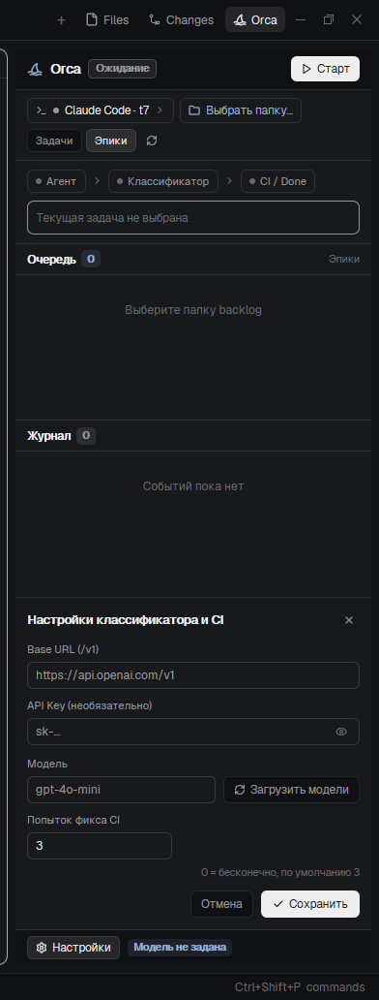

# Orca

A backlog orchestrator layout and mod bundle for Herdr (`layouts/main-orca.json`, `mods/orca/`, `mods/tabs-orca/`) that watches a live coding-agent terminal session, classifies turn completion via an OpenAI-compatible endpoint, polls GitHub CI/CD every 5 minutes with bounded auto-fix retries, and advances through `backlog/*.md` tasks automatically.

## What you see

- **Top tab bar (`mods/tabs-orca/`):** identical to shipped `tabs`, with an **Orca** toggle button right after `Changes` showing `mods/orca/icons/orca.svg` (spinning in `accent` while active, pulsing `working` dot while waiting for CI, `blocked` dot when paused or errored).
- **Right-hand Orca panel (`368px` default in `panel-body` stack):**
  - **Header (`chrome`):** animated Orca icon, status badge (`Ожидание`, `Наблюдение`, `Классификация`, `Ожидание CI`, `Фикс CI`, `Следующая задача`, `Пауза`, `Ошибка`), and `Старт` / `Продолжить` / `Пауза` / `Пропустить` / `Стоп` controls.
  - **Session & backlog bar (`surface`):** live session picker (`claude`, `claude-vps`, `opencode`, etc.), backlog folder selector, `Задачи` / `Эпики` mode pills, and refresh button.
  - **Pipeline strip:** 3-stage animated progress (`Агент` → `Классификатор` → `CI / Done`), active task/epic card, last classifier verdict badge, CI status row with `MM:SS` countdown, retry counter (`attempt/max` or `attempt/∞`), and `Проверить CI` button.
  - **Queue & activity log:** scrollable upcoming queue items and timestamped event log (side-by-side at `width >= 720`, stacked when narrower).
  - **Bottom footer & settings drawer:** persistent `Настройки` button + active model badge, expanding a drawer with `Base URL (/v1)`, masked `API Key` with eye toggle, `Загрузить модели` + model chips, and `Попыток фикса CI` (`0 = бесконечно, по умолчанию 3`).

## How it behaves

- **Session binding:** when `idle`, tracks the active space's backlog and auto-selects the focused/first live agent; when running, locks `boundRun` (`spaceId`, `terminal`, `backlogDir`, `projectRoot`, `on`) so switching spaces does not hijack the run.
- **Start guards:** if the selected session is `blocked`, refuses to send and notifies with `playSound("blocked")`; if already `working`, attaches in `watching` mode without sending a duplicate prompt; otherwise dispatches the next task prompt via `hc send`.
- **Turn classification:** on `working` → `idle`/`done` (after grace window and 2s debounce), reads `hc read --lines 120`, `git status --short`, `git log -1 --oneline`, and `gh` CI status, then calls `POST <baseUrl>/chat/completions`.
- **CI polling & auto-fix:** on `waiting_ci` (or `completed` with `pending` CI), polls `gh run list` / `gh pr checks` every 5 minutes. On `success`, marks the task/epic `[x] DONE` via `writeTextFile` and sends the next item. On `failure`, fetches `gh run view --log-failed` and sends a fix prompt back to the same session up to `maxCiRetries` (`0` = unlimited, default `3`); when exhausted, stops with `notify` + `playSound("blocked")`.

## Built from

- **Layout:** `layouts/main-orca.json` (cloned from `main`, using `tabs-orca` and adding `orca` to `panel-body`).
- **Mods:** `mods/tabs-orca/` (cloned from `tabs`) and `mods/orca/` (`mod.json`, `main.js`, `ui.js`, `parser.js`, `paths.js`, `classifier.js`, `ci.js`, `guards.js`, and 16 monochrome SVGs in `mods/orca/icons/`).
- **Herdr APIs:** `spaces`, `panes`, `focused`, `agents`, `terminals`, `exec`, `hc`, `home`, `readTextFile`, `writeTextFile`, `watchFolder`, `pickFolder`, `run`, `notify`, `playSound`, `theme`, `nextCommand`, `checking`, `window`, `shared`, `setShared`, `settings`, `props`.
- **External programs & network:** `fetch` to user-configured OpenAI-compatible `/v1/models` and `/v1/chat/completions`; `gh` CLI (`run list`, `pr checks`, `run view --log-failed`); `git`; `powershell`/`sh` for listing `.md` files.

## Watch out

- `writeTextFile` only works on local spaces; remote SSH spaces (`space.machine !== null`) run in read-only mode.
- `gh` CLI must be authenticated in the project repository for GitHub CI polling and failed-log retrieval.
- Continuous animations use native GPUI `.spin()`, `.loop()`, and `.frames()` rather than fast JS timers.

## Done when

- `bun test` passes all 34 unit tests across `tests/*.test.js`.
- `herdr-app check` passes on both `mods/orca` and `mods/tabs-orca`.
- Switching to `main-orca` shows the `Orca` button in the top bar and opens the right-hand Orca panel with zero errors in `herdr-app status`.
